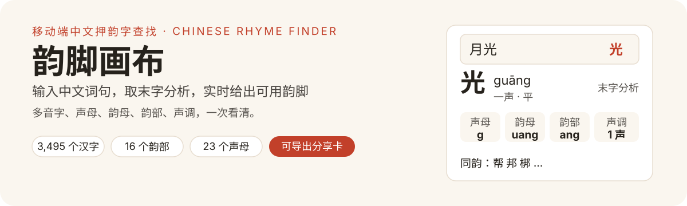
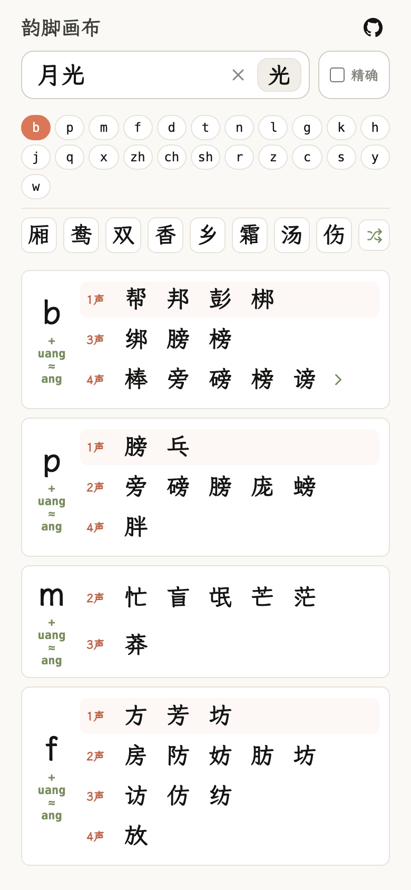

<p align="right"><a href="README.md">中文</a></p>

<p align="center">
  
</p>

<p align="center">
  <a href="https://char-finder.xiaosang.cc/">▶ Try Online</a>
  ·
  <a href="https://github.com/holynova/char_finder">GitHub Repository</a>
</p>

A mobile Chinese rhyme lookup tool: type a Chinese phrase and it analyzes the last character — all its readings, initial, final, rhyme group and tone — and shows usable rhymes in real time. An offline index of 3,495 characters, 16 rhyme groups and 23 initials, ranked by frequency, with one-tap share cards.

## Screenshot

<p align="center">
  
</p>

## Features

- **Input-as-you-type search**: the last character is taken as the rhyme target automatically, with results as you type.
- **All readings shown**: a polyphonic character lists every reading, and you can switch between the rhyme results for each reading.
- **Exact mode**: shows only perfect final matches; broad rhyming is the default, with closer finals ranked first (e.g. `in` before `en` when `in≈en`).
- **Grouped by initial × tone**: results are grouped by 23 initials, then ordered by tones 1–4 （平 level / 扬 rising / 转 dipping / 落 falling); tap an initial to jump to it.
- **Ranked by frequency**: ordered by SUBTLEX-CH character frequency, common characters first; rare characters are included by default for richer choices.
- **Share cards**: export the current query as an image card in one tap, ready to download and share.

## Rhyme Index

- **3,495 characters**, each with all its readings (pinyin, initial, final, rhyme group, tone, frequency tier).
- **16 rhyme groups**: a, ai, an, ang, ao, e, ei, en, eng, er, i, o, ong, ou, u, ü (broadly merged, e.g. uang/iang → ang, in/un → en).
- **23 initials**: b, p, m, f, d, t, n, l, g, k, h, j, q, x, zh, ch, sh, r, z, c, s, y, w.
- Data sources: common-chinese-characters + SUBTLEX-CH-CHR frequency + pinyin-pro; the index is generated by `scripts/build-rhyme-index.mjs` (current index built 2026-06-20).
- Fully local offline lookup, no network needed.

## Develop Locally

```bash
npm install
npm run dev        # generate the index and start the Vite dev server
npm test           # index + build + QA checks
```

Build output goes to `docs/`, for GitHub Pages publishing.

## Tech

- React 19 + TypeScript + Vite; pinyin parsing with pinyin-pro, frequency data from SUBTLEX-CH-CHR.
- Font: LXGW WenKai Screen (霞鹜文楷屏幕版， subset woff2).
- Share cards are rendered off-screen with html2canvas and exported as PNG.

```
src/App.tsx             Main UI: input / initial filter / tone grouping / share cards
src/rhyme.ts            Pinyin parsing, final merging (normalizeFinal), tone naming
src/data/rhyme-index.json   Offline rhyme index (3,495 characters)
scripts/build-rhyme-index.mjs   Index generation script
scripts/qa.mjs          Data QA checks
```
