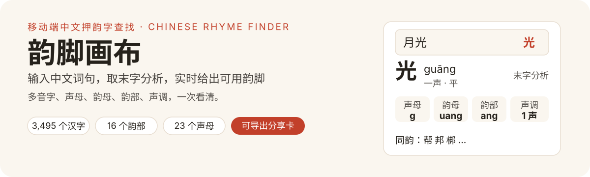
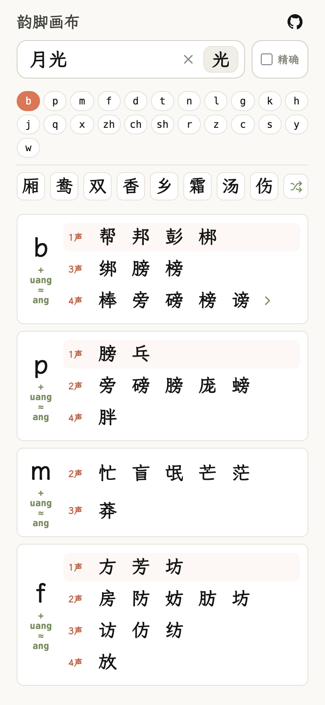

<p align="right"><a href="README.en.md">English</a></p>

<p align="center">
  
</p>

<p align="center">
  <a href="https://char-finder.xiaosang.cc/">▶ 在线使用</a>
  ·
  <a href="https://github.com/holynova/char_finder">GitHub 仓库</a>
</p>

移动端中文押韵字查找工具：输入中文词句，自动取最后一个汉字分析多音字读音、声母、韵母、押韵韵部和声调，实时给出可用韵脚。内置 3,495 个汉字、16 个韵部、23 个声母的离线韵脚索引，按常用程度排序，还能一键生成分享卡片。

## 截图

<p align="center">
  
</p>

## 功能

- **输入即搜索**：自动取最后一个汉字作为押韵目标，边输边出结果。
- **多音字全展示**：一个字有多个读音时全部列出，可切换不同读音对应的韵母结果。
- **精确模式**：只查看完全匹配韵母的结果；默认宽泛押韵，把更精确的韵母排在更前（例如 `in≈en` 时优先展示 `in`）。
- **按声母 × 声调分组**：结果先按 23 个声母分组，再按 1–4 声（平 / 扬 / 转 / 落）排列，点声母可快速定位。
- **按常用程度排序**：基于 SUBTLEX-CH 字频排序，常用字在前；默认包含生僻字结果，便于找更丰富的押韵选择。
- **分享卡片**：一键把当前查询结果生成图片卡片下载分享。

## 韵脚索引

- **3,495 个汉字**，每个字含全部读音（拼音、声母、韵母、韵部、声调、常用层级）。
- **16 个韵部**：a、ai、an、ang、ao、e、ei、en、eng、er、i、o、ong、ou、u、ü（宽泛归并，如 uang/iang → ang，in/un → en）。
- **23 个声母**：b、p、m、f、d、t、n、l、g、k、h、j、q、x、zh、ch、sh、r、z、c、s、y、w。
- 数据来源：common-chinese-characters + SUBTLEX-CH-CHR 字频 + pinyin-pro；索引由 `scripts/build-rhyme-index.mjs` 生成（当前索引生成于 2026-06-20）。
- 纯本地离线查询，无需联网。

## 本地开发

```bash
npm install
npm run dev        # 生成索引并启动 Vite 开发服务器
npm test           # 索引 + 构建 + QA 校验
```

构建产物输出到 `docs/`，用于 GitHub Pages 发布。

## 技术

- React 19 + TypeScript + Vite；拼音解析用 pinyin-pro，字频用 SUBTLEX-CH-CHR。
- 字体：霞鹜文楷屏幕版（LXGW WenKai Screen，子集化 woff2）。
- 分享卡片用 html2canvas 离屏渲染导出 PNG。

```
src/App.tsx             主界面：输入 / 声母筛选 / 声调分组 / 分享卡片
src/rhyme.ts            拼音解析、韵母归并（normalizeFinal）、声调命名
src/data/rhyme-index.json   离线韵脚索引（3,495 字）
scripts/build-rhyme-index.mjs   索引生成脚本
scripts/qa.mjs          数据 QA 校验
```
