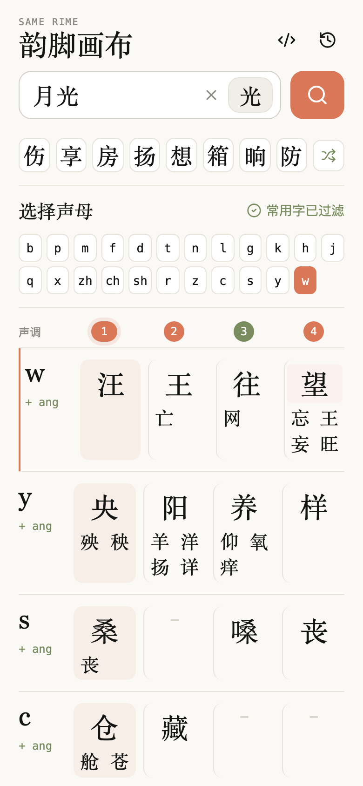

# 韵脚画布

移动端中文押韵字查找工具：输入中文词句，取末字分析多音字读音、声母、韵母、押韵韵部和声调，实时给出可用韵脚。

<p align="center">
  
</p>




- 在线使用：https://holynova.github.io/char_finder/
- 源码仓库：https://github.com/holynova/char_finder
- 版本信息：[package.json](package.json)

## 功能

- 输入即搜索，自动取最后一个汉字作为押韵目标。
- 多音字展示完整拼音，可切换不同读音对应的韵母结果。
- 支持「精确」模式，只查看完全匹配韵母的结果。
- 宽泛押韵会把更精确的韵母排在更前，例如 `in≈en` 时优先展示 `in`。
- 结果按常用程度排序，超过 6 个时用 `>` 展开全屏查看更多。
- 默认包含生僻字结果，便于找更丰富的押韵选择。

## 先找一组韵脚

输入一个中文词句，查看末字的读音；遇到多音字时先切换读音，再比较精确与宽泛匹配的结果。需要更多候选时展开结果列表。

## 本地开发

```bash
npm ci
npm run dev
```

## 构建与验证

```bash
npm run build
```

需要完整浏览器 QA 时运行 `npm test`；它会生成索引、构建页面并执行 `scripts/qa.mjs`。

构建产物输出到 `docs/`，用于 GitHub Pages 发布。
